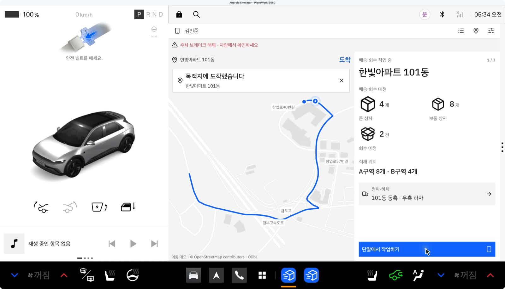

# Pleos Work

택배·화물 운전자가 차량에서 목적지와 물량을 확인하고, 단말 처리 결과를 받은 뒤 다음 방문지로 이어가는 Kotlin / Jetpack Compose 앱입니다. 왼쪽 지도와 오른쪽 Carbon 작업 화면을 함께 사용합니다.



## 먼저 보기

[전체 흐름 영상](https://github.com/minwookshin/pleos-work/releases/download/v1.25-demo/Pleos-Delivery-Pickup-Full-Workflow.mp4) · [APK 다운로드](https://github.com/minwookshin/pleos-work/releases/download/v1.25-demo/Pleos-Work-1.25.apk) · [릴리스와 모든 파일](https://github.com/minwookshin/pleos-work/releases/tag/v1.25-demo)

릴리스의 `Pleos-Delivery-Pickup-Full-Workflow.mp4`를 내려받으면 설치 없이 약 2분 56초의 전체 흐름을 볼 수 있습니다. **QR 연결 → 이동·자동 도착 → 단말 결과 → 재탑승·미처리 보완 → 다음 방문지 → 센터 복귀·인계** 순서입니다.

## 직접 실행

1. [설치 안내](docs/INSTALL.md)에 따라 Pleos Connect 에뮬레이터를 준비합니다.
2. 릴리스의 `Pleos-Work-1.25.apk`를 설치하고 `배송` 앱을 엽니다.
3. [테스트 순서](docs/TEST.md)를 따라 배송·회수와 화물을 확인합니다.

브라우저에서 APK를 바로 실행하는 구조가 아닙니다. 현재 확인한 환경은 **Mac Apple Silicon · Pleos Connect 2.1.0 ARM64 · Android Automotive API 34**입니다.

## 동작 범위

- 기사별 예시 배차와 큰 상자·보통 상자·회수 수량, 적재 위치
- 이동 중 진입 정보, 도착 후 정차·하차 정보
- 배송·회수 단말 결과, 재탑승 확인, 미처리 보완·사유 인계
- 화물 도크 배정, 상차·출발 준비, 하차·인수, 회수·센터 인계
- 화면을 전환해도 유지되는 왼쪽 지도, 큰 글자, 설명이 있는 아이콘과 키보드 포커스

기본 모드의 경로 이동·자동 도착, QR·기사 인증·단말 결과는 로컬 체험 시나리오입니다. 실제 휴대폰 앱이나 TMS 서버와 연결하지 않았습니다. Pleos Vehicle / NaviHelper 연동 코드는 포함하지만, 공개 에뮬레이터의 실제 지도 배경·GPS 주행·도착까지 성공한 제품으로 소개하지 않습니다.

## 빌드

Android Studio에서 이 폴더를 열고 Android SDK 35와 JDK 17 이상을 준비합니다. SDK 경로는 자신의 환경에서 설정하며 `local.properties`는 공유하지 않습니다.

```sh
./gradlew :app:testDebugUnitTest :app:assembleDebug
```

Kotlin 2.1.20 · AGP 8.9.2 · Gradle 8.11.1 · compileSdk 35 · targetSdk 34. Pleos Vehicle 2.3.2와 NaviHelper 3.0.5는 `settings.gradle.kts`의 공식 Maven 저장소에서 가져옵니다. SDK 접근 조건은 [Pleos 개발자 가이드](https://document.pleos.ai/docs/connect/guide/getting-started/application-development/setup-connect-sdk-emulator)를 확인하세요.

## 확인한 내용

1.25에서 단위 검사 131개가 통과했습니다. 2026-11-02에는 김민준 배차의 세 방문지와 배송·회수·재탑승·센터 인계 전체를 직접 확인했습니다. [검증 범위와 영상 설명](docs/TEST.md)을 참고하세요.

Carbon 색상과 IBM Plex Sans KR을 Compose에 적용한 프로젝트입니다. 공식 Carbon Android 라이브러리 또는 접근성 인증 제품은 아닙니다. 구성 요소별 출처와 라이선스는 [THIRD_PARTY_NOTICES.md](THIRD_PARTY_NOTICES.md)에 있습니다.
