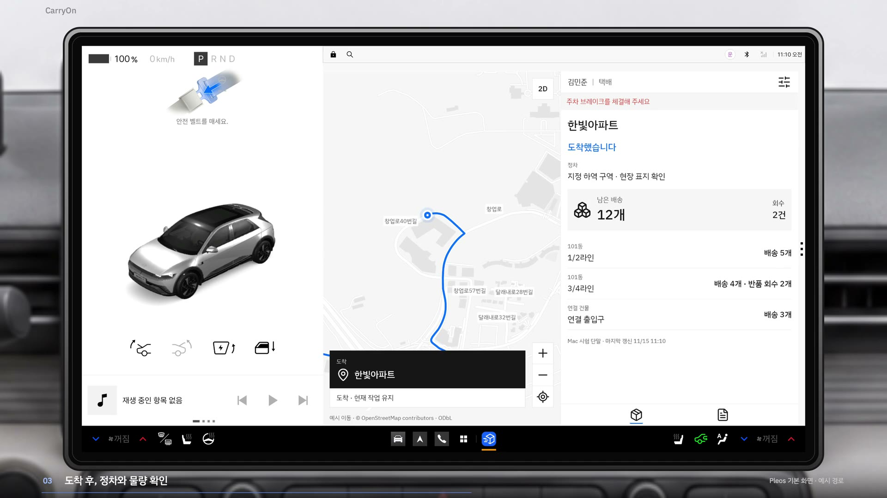

# CarryOn

택배·화물 기사가 내비게이션 옆에서 현재 방문지와 남은 업무를 확인하는 Pleos Connect용 앱입니다. 배송·회수·인수는 기존 휴대폰이나 단말에서 처리하고, CarryOn은 그 결과를 차량 화면에 반영합니다.

**[시연 영상 · 53초](demo/CarryOn-Demo.mp4)** · **[APK 다운로드 · 2.10](apk/CarryOn-2.10-release.apk)** · **[설치 안내](docs/INSTALL.md)**

**업무 연결 → 이동·도착 → 처리 결과 확인 → 다음 방문지 안내**

직접 실행하려면 Pleos 에뮬레이터, Python 3, Android SDK의 `adb`가 필요합니다.

1. APK를 내려받아 Pleos 에뮬레이터에 설치합니다.
2. 이 저장소를 내려받고, 프로젝트 폴더에서 `sh scripts/run-local-integration.sh`를 실행합니다.
3. Mac에서 `http://127.0.0.1:8798/control`을 열고, 차량 앱의 **설정 → 단말 연결**에 나온 코드를 입력해 승인합니다.
4. 차량 앱에서 **설정 → 앱 지도 · 이동 시험**을 선택합니다. Mac의 시험 화면에서 배송·회수 결과와 다음 방문지를 보내며 흐름을 확인합니다.

확인 환경은 **Mac Apple Silicon · Pleos Connect 2.1.0 ARM64 · Android Automotive API 34 · 2560×1440 px · 160 dpi**입니다.

Kotlin과 Carbon 디자인 체계로 만들었습니다. 시연에는 예시 경로와 모의 업무 데이터를 사용하며, 실제 운송사 시스템·실차 내비게이션·냉동 센서 연동은 추후 검증할 예정입니다.

[전체 시험 순서](integration/README.md) · [검증 결과](docs/TEST.md) · [API·센서 규격](integration/CONTRACT.md) · [출처·라이선스](THIRD_PARTY_NOTICES.md)
