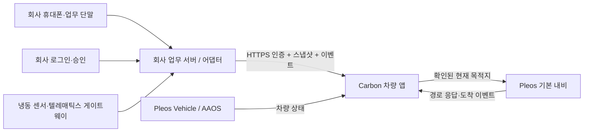

# 업무·인증·차량·센서 연결 계약 v1

2026-11-10. 제품 요구사항은 공유 MD 두 개를 따른다. 아래는 그 요구사항을 실제 코드에 적용한 **프로젝트의 연동 계약**이며, Pleos가 운송회사 업무 API나 냉동 센서 API를 제공한다는 뜻이 아니다.

## 선택한 연결 방식

차량 앱은 회사 시스템의 기록을 읽는 클라이언트로 둔다. 휴대폰/업무 단말에서 스캔·증빙·서명한 결과를 회사 서버가 정규화하고, 차량은 스냅샷과 커서 이벤트를 읽는다. 운전자가 차량에서 동일 작업을 다시 완료하지 않는다.



현재 `integration/server.py`가 회사 서버·승인·센서 공급을 **로컬 가상 데이터**로 대체한다. 차량의 API 클라이언트·토큰 보관·폴링·개별 기록 적용은 실제 구현이다. 실제 회사 SDK와 센서 하드웨어가 정해지면 서버 어댑터를 교체하며 차량 UI에 각 회사의 스캔 절차를 복제하지 않는다.

## 인증

- 차량은 비밀키를 보관하지 않는 공개 클라이언트 `pleos-work-car`다.
- RFC 8628 Device Authorization 사용. 사용자가 연결을 선택한 경우에만 코드를 발급한다. 차량 코드와 휴대폰/단말 코드를 확인하고 기사 계정으로 승인한다.
- 운영용 승인 웹은 회사 IdP와 연결한다. 휴대폰 네이티브 로그인이 필요하면 외부 브라우저의 Authorization Code + PKCE를 사용한다. 현재 시험 서버는 실제 SSO·PKCE 로그인을 구현하지 않는다.
- 권한은 `work:read cargo:read`. 운송 상태 수정·문 열기·냉동기 제어 권한을 차량 토큰에 주지 않는다.
- 시험 코드는 10분, 최소 폴링 2초. `authorization_pending`, `slow_down`(+5초), `access_denied`, `expired_token`을 처리한다. 실제 IdP의 `interval`과 만료를 따른다.
- 시험 액세스 토큰은 15분, 갱신 토큰은 24시간. 갱신 시 교체하고 이전 갱신 토큰 재사용 시 같은 토큰 계열을 취소한다. 회사 정책에 맞춰 서버가 실제 수명을 결정한다.
- APK에 client secret을 넣지 않는다. 토큰은 Android Keystore 키의 AES-256-GCM으로 암호화해 별도 저장한다. 작업 기록에는 토큰을 넣지 않는다. 백업/기기 이전에서 앱 데이터를 제외한다.
- 토큰 만료·연결 중지·로그아웃은 남은 업무를 삭제하지 않는다. 계정/스트림이 바뀌면 이전 기록을 보존하고 승인된 계정의 스냅샷을 받는다. 공유 차량 운영 시 데이터 보관·기사 교대 접근 정책은 회사와 추가 확정해야 한다.
- 운영 API는 HTTPS만 허용한다. 디버그 빌드만 `127.0.0.1`·`localhost`의 HTTP 시험 서버를 허용한다. 응답 리디렉션을 따르지 않으며, 인증 정보가 다른 호스트로 전달되지 않는다.

## HTTP

OAuth 요청 본문은 `application/x-www-form-urlencoded`, 업무 응답은 JSON이다. 업무 조회에는 `Authorization: Bearer …`를 보낸다. 연결/읽기 시간 제한은 각 5초, 응답 최대 4MB. 앱 동기화는 2초 간격이며 장애 시 최대 30초까지 간격을 늘린다.

| 경로 | 동작 |
|---|---|
| `POST /oauth/device_authorization` | `client_id`, `scope` → `device_code`, `user_code`, `verification_uri`, 선택적 `verification_uri_complete`, `expires_in`, `interval` |
| `POST /oauth/token` | device_code 또는 refresh_token grant → `access_token`, 선택적 `refresh_token`, `token_type`, `expires_in`, 프로젝트 확장 `account_id` |
| `POST /oauth/revoke` | `token` 취소. 로컬에서는 같은 토큰 계열 전체 취소 |
| `GET /v1/work/snapshot` | 승인된 계정의 검증된 `WorkLedger` |
| `GET /v1/work/events?after={cursor}` | `accountId`, `streamId`, `cursor`, `events` |

`/control/*`는 시험 단말 전용이고 차량 API가 아니다. 루프백·Host 확인, HttpOnly/SameSite 쿠키, Origin·CSRF 검사를 적용한다. 쿠키/CSRF는 실제 회사 사용자 인증을 대신하지 않으므로 공개 배포하지 않는다.

## 업무 모델과 전달 보장

`Operations.kt`가 실행 가능한 모델이다. 배차 예시는 `app/src/main/assets/work/*.json`에 있다.

| 항목 | 의미 |
|---|---|
| `accountId` | 서버가 인증 토큰에 연결한 기사 계정. 응답 계정과 토큰 계정이 일치해야 함 |
| `streamId` | 배차/연결 데이터 집합 식별자. 교체 시 전체 스냅샷을 받고 이전 집합 보존 |
| `cursor` | 전송 순서. 서버 재시작에도 단조 증가하며 클라이언트가 마지막 반영 지점을 저장 |
| `visit.id`, `round` | 작업 구역/방문과 회차. 같은 주소 재방문을 주소 문자열로 합치지 않음 |
| `task.id`, `number` | 시스템 고유 작업 ID와 운전자에게 보이는 원래 물품 번호. 재번호 부여하지 않음 |
| `building`, `entrance` | 공급자가 확인한 건물·출입구. 주소로 연결 통로나 선반을 추정하지 않음 |
| `visit.timeWindow`, `cargoInstructions`, `receiptInstructions`, `plannedStop` | 선택적 시간·화물·인수·예정 정차 조건(각 300자 이내). 공급된 정보만 표시하며 없으면 임의 생성하지 않음 |
| `location` | 실제로 공급된 차량 내부 적재 위치만. 누락 시 숨김 |
| `quantity`, `completed` | 전체/처리 수량. `0 ≤ completed ≤ quantity` |
| `sync` | `OPEN`, `LOCAL`, `PENDING`, `CONFIRMED`. 공급자가 알려 준 단계만 사용 |
| `revision` | **각 개체의** 개정 번호. 다른 방문지의 늦은 결과도 해당 작업이 새 개정이면 적용 |
| `currentVisitId` | 업무 시스템이 확인한 현재 작업. 수량 0·도착·재탑승만으로 바꾸지 않음 |
| `dayClosed`, `drivingEnded` | 업무 종료와 오늘 운전 종료를 각각 기록. 작업 삭제/완료를 만들지 않음 |

이벤트 종류는 `TASK`, `CURRENT`, `FACILITY`, `SENSOR`, `DAY`, `DRIVING`, `NOTE`다. 공통 필드는 `id`, `accountId`, `streamId`, `revision`, `kind`, `entityId`, `occurredAt`이다. 시각은 UTC Unix 밀리초.

```json
{
  "accountId": "demo-parcel", "streamId": "example-stream", "cursor": 41,
  "events": [{
    "id": "unique-event-id", "accountId": "demo-parcel", "streamId": "example-stream",
    "revision": 9, "kind": "TASK", "entityId": "p-1-009",
    "completed": 1, "sync": "CONFIRMED", "occurredAt": 1794300000000
  }]
}
```

중복 이벤트 ID와 오래된 개체 개정은 재적용하지 않는다. 계정/스트림 불일치·잘못된 수량·알 수 없는 개체·형식 오류가 있는 배치는 커서를 진행하지 않는다. 신규 작업·구역 추가나 모델 변경은 새 스트림의 스냅샷으로 제공한다. 데이터 수신을 P·정차·현재 화면·운전 종료 여부로 차단하지 않는다.

앱 프로세스가 종료되어도 기록과 커서는 남는다. 서버의 이벤트 보관 범위에서 커서가 만료되는 운영 환경은 별도 `resync_required` 응답과 전체 스냅샷 복구 계약을 추가해야 한다. 현재 로컬 서버는 이벤트를 지우지 않으므로 커서 만료는 발생하지 않는다. 실시간 push나 영구 백그라운드 서비스는 구현하지 않았다.

## 화물 현장

- 내비 도착: 위치/경로상 도착 시각, 현장 체류 시간.
- `FACILITY`: `UNKNOWN` / `REGISTERED` / `CALLED` / `WORKING`, 확인된 `dock`, 접수 기록 시각.
- `TASK`: LOAD / UNLOAD / RECEIPT / CONTAINER / HANDOFF 각각 별도 기록.
- 도착했다고 접수·도크를 생성하지 않는다. 하역 24개 처리 후에도 인수 1건은 별도로 남는다.
- 미정 출차 시간·다음 배차는 미수신으로 표시한다. 타이머가 도크를 자동 배정하지 않는다.

## 냉동 센서 공통 형식

직접 BLE/GATT·CAN 프로파일을 임의로 정하지 않는다. 제조사 장치의 실제 제공 형식은 게이트웨이에서 아래 형식으로 변환한다. 현재 앱은 읽기만 하며 단일 화물칸만 다룬다.

```json
{
  "sensorId": "supplier-stable-sensor-id", "compartment": "단일 화물칸",
  "measuredC": -19.2, "setpointC": -19.0, "doorOpen": false,
  "observedAt": 1794300000000, "maxAgeMs": 15000,
  "available": true, "revision": 18
}
```

- `measuredC`: 화물칸 **공기** 온도(°C). 제품 내부 온도·품질·안전 판정이 아니다.
- `setpointC`: 센서/냉동기에서 읽은 설정값. 요구 온도나 실제 측정값으로 대신 채우지 않는다.
- 요구 범위는 작업의 `requiredLow/requiredHigh`다. 측정 이탈과 설정 불일치를 각각 표시한다.
- `observedAt`은 장치 관측 시각, `maxAgeMs`는 공급자 갱신 주기/SLA에 맞춘 유효시간이다. 시험은 5초 측정/15초 유효, 앱 허용 범위는 1–300초다. 이를 모든 실제 센서의 기본값으로 확정하지 않는다.
- `available=false`, 미수신, 미래 시각 또는 유효시간 경과는 현재 확인 불가. 마지막 값·시각은 과거 값으로만 표시한다. 문·설정도 같은 시점의 기록이다. 독립 주기 장치라면 서버에서 동시 관측/유효성을 맞추거나 별도 필드별 시각 모델로 확장해야 한다.
- 문이 열려 있어도 온도 이탈은 유지한다. 운전석 문 API를 적재함 문으로 쓰지 않는다.
- 최근 720건은 당시 방문지와 요구 범위를 함께 보관한다. 앱의 최근 기록이지 법정/품질 보증용 장기 보관 시스템은 아니다.
- 실제 연결 전에 제조사별 식별자·단위·관측 시계·센서 교체·캘리브레이션·미수신 주기를 확정해야 한다. 원격 냉동기 제어·다구획·시동 종료 후 감시는 범위 밖이다.

## 실제 Pleos 연결

- AAOS/Pleos SDK의 지원 여부·권한·읽기 가능·값 상태를 검사한다. 속도 0만으로 주차라 판단하지 않고 기어 P 및 운전 제한을 함께 본다.
- `CAR_ENERGY` 읽기 권한을 선언하고 지원되는 연료/배터리를 조회한다. 운송 현황에서만 표시하며 미지원 값을 고정 예시로 채우지 않는다.
- Native 목적지 요청은 현재 방문지 변경 또는 명시적 재시도에 한 번 전송한다. 같은 방문지 결과가 다시 왔다고 내비를 반복해서 열지 않는다.
- 요청 전달, 목적지 응답 확인, 실제 도착 이벤트를 구분한다. 다른 목적지·오래된 도착·안내 중단·무응답을 자동 도착으로 처리하지 않는다.
- 실제 지도 배경과 GPS 재생은 제공된 Pleos 에뮬레이터의 제약으로 남는다. 앱의 예시 지도 이동으로 그 제한을 해결했다고 표시하지 않는다.

## 공식 근거

- [Pleos NaviHelper 소개](https://document.pleos.ai/en/docs/pleos-only/connect-sdk-pleos/NaviHelper/intro): 경로·목적지·내비 화면·리스너.
- [NaviHelper 권한](https://document.pleos.ai/en/api-reference/connect-sdk-pleos/NaviHelper/declaring-permissions).
- [Pleos Vehicle SDK](https://document.pleos.ai/en/docs/pleos-only/connect-sdk-pleos/Vehicle/intro): 기능 지원 확인·값 조회·권한. 냉동 화물칸 전용 API가 확인된 것은 아니다.
- [RFC 8628](https://datatracker.ietf.org/doc/html/rfc8628): Device Authorization와 폴링 오류/승인.
- [RFC 8252](https://datatracker.ietf.org/doc/html/rfc8252): 네이티브 앱 외부 브라우저·PKCE.
- [Android Keystore](https://developer.android.com/privacy-and-security/keystore), [Android 암호화](https://developer.android.com/privacy-and-security/cryptography): 키 보관·AES/GCM.

## 2.1 설정과 표시의 경계

최초 업무·차량 기본 설정은 배정을 생성하지 않는다. 설정 저장은 기존 인증·업무 기록·내비 경로를 유지하며, 새로운 회사 프로필은 수신한 배정을 따른다. 회사 데이터의 요구 온도를 로컬 차량 옵션으로 덮어쓰지 않는다. 예시 업무 전환은 별도 조작이며 이전 회사 기록을 보존한다.

처리 결과 전송 대기, 하역 후 인수 미완료, 현재 방문지 처리 완료/다음 배정 대기, 오늘 운전 종료, 업무 종료를 구분한다. 화면 정렬·펼쳐 보기·포커스 복원은 원래 작업 ID와 회사 상태를 변경하지 않는다.
